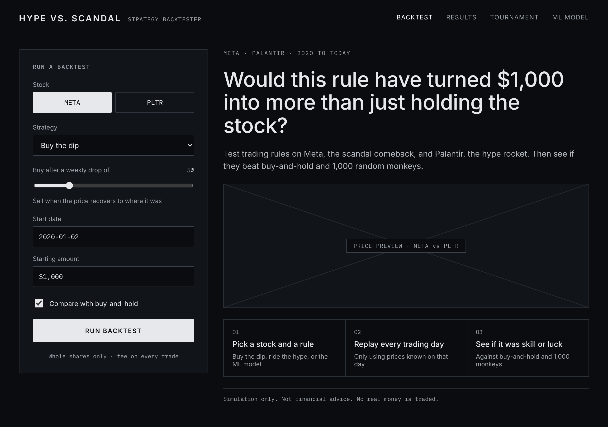
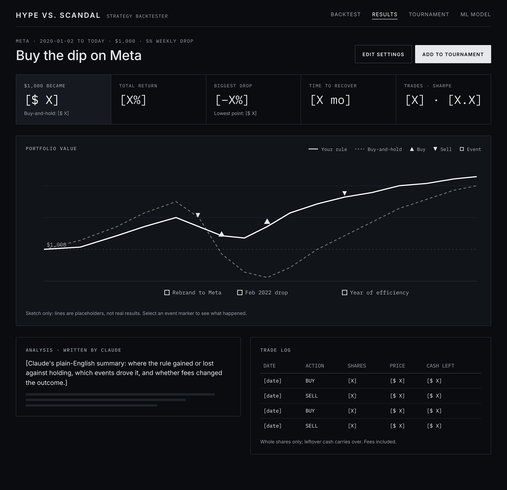
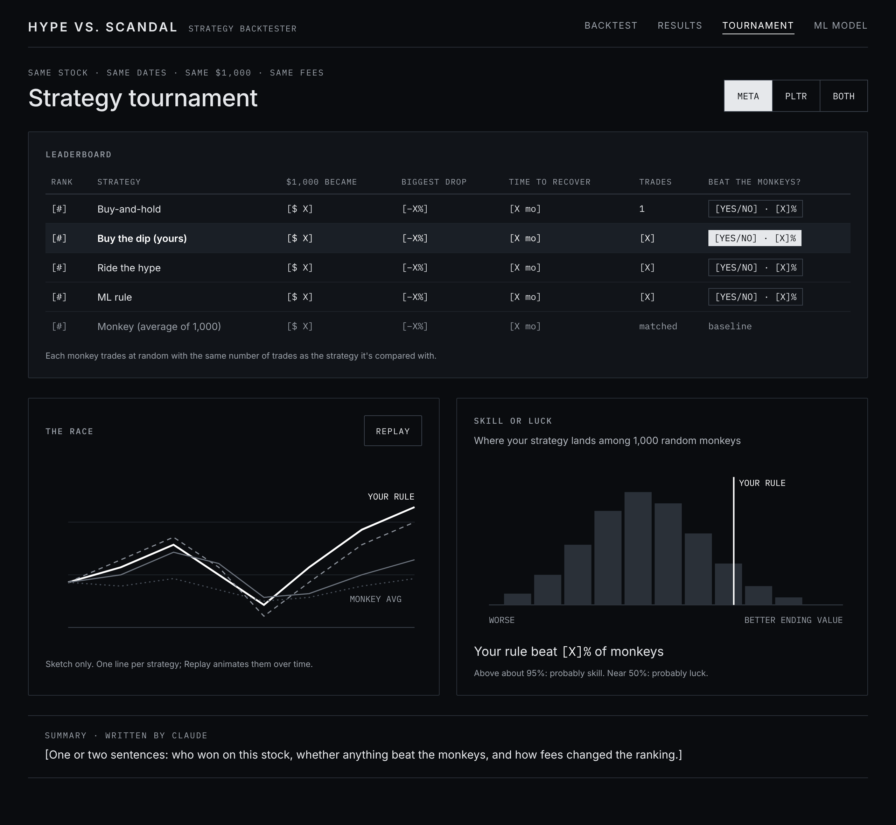
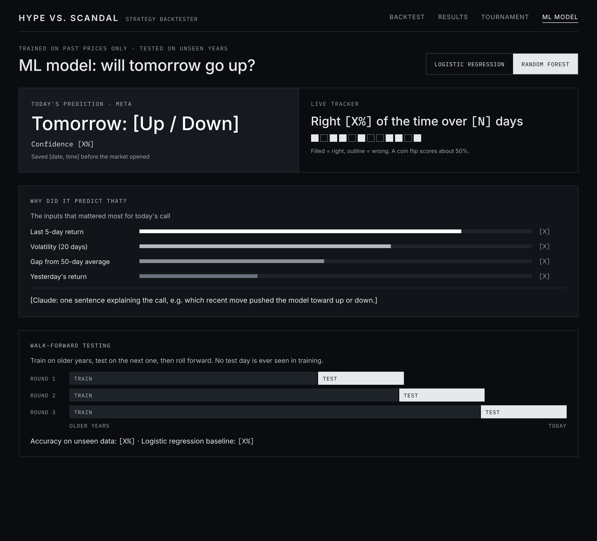
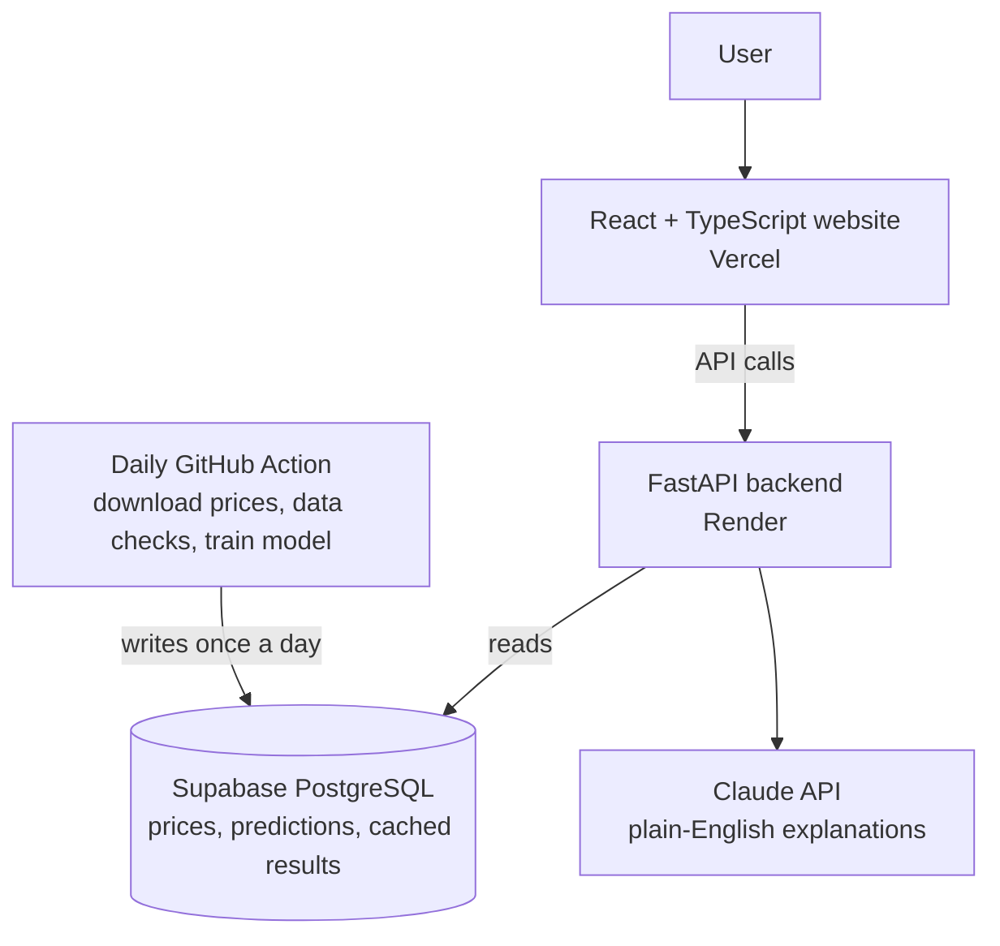

# Hype vs. Scandal: Stock Strategy Backtester

**Would this trading rule have turned $1,000 into more than just holding the stock, or was it just luck?**

Hype vs. Scandal is a full-stack backtesting app that tests trading strategies on two stocks with very different personalities: **Meta (META)**, the scandal comeback, and **Palantir (PLTR)**, the hype rocket. Every strategy starts with $1,000, buys whole shares, pays trading fees, and competes against buy-and-hold and **1,000 randomly trading "monkeys"** to separate real skill from luck.


> **Live demo:** coming soon (target: December 2026)

---

## Why this project

Most student backtesters report a big return and stop there. That number is usually wrong: it peeks at future prices, ignores fees, or gets lucky. This project is built around the questions a trading desk would actually ask:

- Did the strategy beat **simply holding the stock**?
- Did it beat **random trading** with the same number of trades?
- How deep was the **worst drop**, and how long did the money take to **recover**?
- Does it still work on **data it has never seen**?

## Features

### v1: Core backtester
- Pick **Meta or Palantir**, a strategy, a start date, and a starting amount (default $1,000)
- Simulates **whole-share** trades with leftover cash and a **fee on every trade**
- **Equity chart** comparing the strategy against buy-and-hold, with buy and sell markers
- **Scorecard** in plain words: ending value, total return, biggest drop, time to recover, number of trades, Sharpe ratio
- **Drama timeline:** clickable markers for major events (Cambridge Analytica, the Meta rebrand, Palantir's S&P 500 entry, and more)

### v2: Strategy tournament
- **Strategies:** buy-and-hold, buy the dip, ride the hype, and an ML rule
- **Monkey baseline:** 1,000 random traders matched to each strategy's trade count
- **Skill-or-luck score:** the share of monkeys each strategy beat
- **Leaderboard** with "beat the monkey?" badges and a race chart
- **S&P 500 (SPY) benchmark** and a Meta vs. Palantir toggle
- **Claude-written explanations** of each result in plain English

### AI rule builder (agent with tool-calling)
Type a rule in plain English, like *"buy Palantir after a 7% weekly drop"*. A Claude agent (`POST /agent/rule`) maps it onto the backtester by calling the app's own tools:

| Tool | What it does |
| --- | --- |
| `list_strategies` | Supported stocks, rule templates, and their parameters |
| `run_backtest` | Runs the rule through the same engine as the UI (fees, whole shares, no look-ahead) |
| `get_metrics` | Scorecard next to buy-and-hold on the same dates |
| `compare_to_monkeys` | Share of 1,000 random traders with the same trade count that the rule beat |

Claude then explains in plain English how it read the rule, whether it beat buy-and-hold, and whether it beat the monkeys. The response includes every tool call, so the reasoning is visible and the backtest opens on the normal results screen. If a rule can't be expressed (another stock, short selling, news signals), the agent says so instead of guessing.

### v3: Later ideas
- Live prediction tracker that saves each day's prediction before the market opens and scores it the next day
- Market-mood detection (calm, trending, volatile) with clustering
- Headline sentiment as a trading signal

## Wireframes

Early wireframes of the four main screens. All numbers are placeholders like `[$ X]` until real results exist, and chart lines are sketches, not data.

**1. Run a backtest:** pick a stock, a strategy, the drop threshold, a start date, and the starting amount.



**2. Results:** scorecard, portfolio value vs. buy-and-hold with buy, sell, and event markers, Claude's analysis, and the trade log.



**3. Strategy tournament:** leaderboard with "beat the monkeys?" scores, the race chart, and where your strategy lands among 1,000 random monkeys.



**4. ML model:** today's prediction, the live tracker, the features behind the call, and how walk-forward testing works.



## The ML rule

A model predicts whether tomorrow's price will go up or down, using only information available up to today:

- **Features:** recent returns, volatility, and gaps from moving averages
- **Models:** logistic regression as the baseline, then a random forest (Scikit-learn)
- **Walk-forward testing:** train on older years, predict the next period, roll forward. No test day is ever seen during training.
- **Explainability:** a "why did it predict that?" view of the most important features

Stock prices are hard to predict. Results are reported honestly, even when the model barely beats a coin flip.

## Methodology: keeping results honest

| Common backtesting mistake | How this project prevents it |
| --- | --- |
| Look-ahead bias (using future prices) | Every rule sees only data up to the simulated day; an automated test changes future prices and fails if past signals change |
| Ignoring trading costs | A fee is charged on every buy and sell |
| Overfitting to the past | Walk-forward validation on out-of-sample data |
| Mistaking luck for skill | 1,000 randomized baselines with matched trade counts |
| Judging by profit alone | Max drawdown, time to recover, and Sharpe ratio reported for every run |
| Unrealistic fills | Whole shares only, with leftover cash tracked |

## Architecture



**Designed for speed:** downloading prices and training the model happen in a scheduled daily job, never when a user clicks. Backtests and all 1,000 monkey simulations are vectorized with NumPy, and finished results are cached.

## Tech stack

| Layer | Tools |
| --- | --- |
| Frontend | React, TypeScript, Vite, Tailwind CSS, Recharts |
| Backend | Python, FastAPI |
| Backtesting and ML | Pandas, NumPy, Scikit-learn |
| Database | Supabase (PostgreSQL) |
| AI | Claude API |
| Data | Daily historical prices (yfinance) |
| Testing and CI/CD | Pytest, GitHub Actions |
| Hosting | Vercel (frontend), Render (API) |

## Project structure

```
hype-scandal-backtest/
├── frontend/   # React + TypeScript web app
├── backend/    # FastAPI app: strategies, simulator, tournament, metrics
├── jobs/       # Scheduled data download, data checks, model training
└── .github/    # CI workflows and the daily data job
```

## Run locally

```bash
# Backend (http://localhost:8000)
cd backend
python -m venv .venv && .venv/Scripts/activate   # macOS/Linux: source .venv/bin/activate
pip install -e ".[dev]"
cp .env.example .env                             # then add your ANTHROPIC_API_KEY
uvicorn app.main:app --reload

# Frontend (http://localhost:5173), in a second terminal
cd frontend
npm install
npm run dev
```

In development the frontend sends `/api/*` requests to the backend on port 8000. In production, set `VITE_API_URL` to the deployed API's address. Backtests need price CSVs in `backend/data/prices/` (see the README there).

## Results

Results will be published here after v1 launches, including:

- Each strategy's ending value, biggest drop, and time to recover on Meta and Palantir
- The share of random monkeys each strategy beat
- ML model accuracy on unseen data
- Measured run time for a full tournament

## Roadmap

- [ ] Phase 0: Repo, CI, Supabase, and app scaffolding
- [ ] Phase 1: Price data pipeline with daily updates and data checks
- [ ] Phase 2: Backtest engine, metrics, and look-ahead test
- [ ] Phase 3: Web app v1 deployed (target: December 15, 2026)
- [ ] Phase 4: Strategy tournament with 1,000 monkeys
- [ ] Phase 5: ML rule with walk-forward testing
- [ ] Phase 6: Claude explanations and final polish (target: January 19, 2027)

## Disclaimer

This is an educational simulation, not financial advice. No real money is traded. Past performance does not predict future results.

## Author

**Serene Plummer**, Computer Science at the University of North Texas
[LinkedIn](https://linkedin.com/in/serenep) · [Portfolio](https://serene4444.github.io/myPortfolio/)
